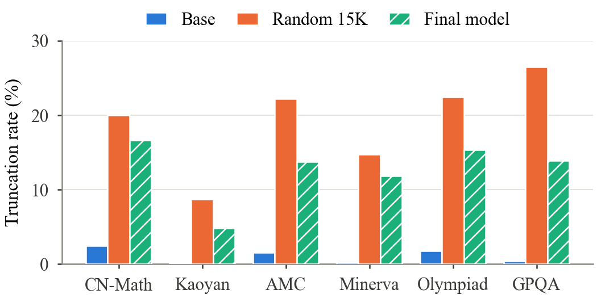

# Data Selection and Training Budget for Reasoning Supervised Fine-Tuning of Qwen2.5-3B-Instruct

**Hanze Li, Sijie Chen, Yuan Zhou, Yiming Liang**, Group 2, Trustworthy Machine Learning (Fall 2026), Virginia Tech

> Markdown version of the submitted report, [`paper/Group2_report.pdf`](paper/Group2_report.pdf) (NeurIPS 2025 style,
> source `paper/report.tex`). Every experiment, including intermediate and follow-up runs, is documented in
> [`FULL_REPORT.md`](FULL_REPORT.md).

**Abstract.** Supervised fine-tuning (SFT) on long chain-of-thought (CoT) traces is a common way to teach small language
models to reason, but it is less clear which traces they should be trained on. We study this question for Qwen2.5-3B-Instruct
with a budget of 15K examples taken from a 100K subset of AceReason-1.1-SFT. We select the examples with four simple steps
that need no labels or model inference: we keep only math problems, remove duplicate prompts, drop examples that do not fit in
the training context, and sample in proportion across data sources and solution lengths. Trained on the selected data for five
epochs, our final model reaches a macro pass@8 of 59.0% on the six leaderboard benchmarks, compared with 53.9% for the base
model and 54.9% for a model trained on a random 15K subset. It also has the highest macro pass@1 (26.9%). Most of the
improvement comes from fewer answers being cut off at the 32,768-token generation limit.

## 1 Introduction

A common way to improve the math reasoning of a language model is to fine-tune it on long CoT traces written by a stronger
reasoning model [Guha et al., 2026, Liu et al., 2025, Muennighoff et al., 2025]. This does not always work well for small
models. They can struggle to learn from long traces [Li et al., 2025], and models trained to reason at length often keep
reasoning well past the point where it helps [Chen et al., 2024]. When the data budget is limited, it therefore matters which
examples are used for training.

In this project [reds-lab, 2026], we fine-tune Qwen2.5-3B-Instruct [Yang et al., 2024] on 15K examples taken from a 100K
subset of AceReason-1.1-SFT [Liu et al., 2025], whose responses are long CoT traces generated by DeepSeek-R1. The question is
whether choosing these 15K examples carefully works better than picking them at random. Our contributions are:

- A simple selection pipeline that needs no labels or model inference and produces complete, deduplicated math demonstrations
  while keeping the original mix of sources and lengths (Section 2).
- A final model, trained for five epochs on the selected data, that improves macro pass@8 by 5.1 points over the base model
  and macro pass@1 by 2.3 points over the random baseline, with 95% confidence intervals that exclude zero in both cases
  (Section 4).
- An analysis showing that the fine-tuned models lose many answers to the generation limit, that fewer such cut-offs account
  for most of our gain, and how much of the gain comes from the data versus the longer training (Section 4).

## 2 Data selection strategy

**Random baseline.** The training pool contains 100,000 examples, of which 67,432 are math and 32,568 are code. The random
baseline samples 15,000 of them uniformly with a fixed seed and no filtering. Of these, 556 are longer than the 16,384-token
training context and get truncated, so their final answers never appear in the training target.

**Motivation and hypothesis.** A random sample spends part of the budget on examples that are of little use to a 3B model
evaluated on math and science: code traces, repeated questions, and solutions too long for the training context, whose final
answers are cut off. We hypothesize that, with the same 15K budget, training only on complete, in-domain, and non-redundant
demonstrations improves reasoning over a random sample, in particular because the model learns to finish its answers instead
of running past the generation limit.

**Selected set.** We apply four steps in order. First, *domain filtering* keeps only the math examples; the benchmarks are all
math or science, so the code traces are of little use. Second, *exact deduplication* removes repeated prompts (7,730 among the
math examples) so that each question appears only once; Liu et al. [2025] find that the number of distinct prompts matters more for SFT than
the number of responses per prompt. Third, *length
filtering* keeps only examples whose full conversation fits in the 16,384-token context under the Qwen chat template (removing
2,292), so every training target ends with its final answer and end-of-turn token. Fourth, *stratified sampling* with
proportional allocation draws 15,000 of the remaining 57,410 examples across data sources (NuminaMath-CoT and
OpenMathReasoning) and length bands (up to 4K, 4-8K, and 8-16K tokens). This keeps the same mix of sources and of short and
long solutions as in the filtered pool, with length serving as a rough proxy for difficulty. The selected set has 107.6M
training tokens per epoch (113.4M for the random set) and a median length of 6.5K tokens, and it shares 2,252 examples with the
random set.

**Why these steps.** Several studies show that a small, carefully chosen fine-tuning set can match or beat a much larger
unfiltered one, both for alignment [Zhou et al., 2023] and for reasoning [Muennighoff et al., 2025, Ye et al., 2025]; question
filtering and the mix of data sources also play a central role in recent data recipes for reasoning models [Guha et al.,
2026]. Our pipeline needs no model scoring, embeddings, or answer keys. We also checked for contamination and found six pool
prompts that appear verbatim in a benchmark. One of them ended up in each 15K set; we kept it and report it here rather than
removing it from only one of the two sets.

## 3 Experimental setup

**Training.** Both models are trained with full-parameter SFT in LLaMA-Factory [Zheng et al., 2024], using DeepSpeed ZeRO-3
[Rajbhandari et al., 2020], FlashAttention-2 [Dao, 2024], and the Liger fused linear cross-entropy kernel [Hsu et al., 2024].
The loss is computed on response tokens only. Table 1 lists the hyperparameters. The final model is first trained for three
epochs; we then resume from its epoch-3 weights, optimizer, and scheduler states and train for two more epochs on a five-epoch
cosine schedule.

**Table 1: Training hyperparameters of the final model and the random baseline.**

| | Final model | Random baseline |
|---|---|---|
| Training data | Selected 15K (107.6M tokens/epoch) | Random 15K (113.4M tokens/epoch) |
| Epochs (steps) | 5 (9,375) | 3 (5,625) |
| Learning rate | 5e-6, cosine, no warmup; epochs 4-5 decay from 1.7e-6 to 0 | 5e-6, cosine, no warmup |
| Tokens seen | 538.2M | 338.8M |
| Hardware (time) | 4x L40S (8.6 h) + 4x A100 (4.4 h) | 4x L40S (9.2 h) |
| Base model | Qwen2.5-3B-Instruct, full-parameter SFT, loss on response tokens | same |
| Optimizer | AdamW, betas (0.9, 0.999), weight decay 0, gradient clipping 1.0 | same |
| Global batch size | 8 (4 GPUs x micro-batch 1 x gradient accumulation 2) | same |
| Max. sequence length | 16,384 tokens, Qwen chat template | same |
| Precision, kernels | bf16, DeepSpeed ZeRO-3, FlashAttention-2, Liger kernel | same |

**Benchmarks and metrics.** We evaluate on AIME24, MATH-500, CN-Math 2024, Kaoyan, AMC, Minerva, OlympiadBench, and GPQA with
the course evaluation harness, which generates answers with vLLM [Kwon et al., 2023] and grades the last boxed answer by
symbolic equivalence. For each question we draw n = 8 samples with temperature 0.6, top-p 0.95, and at most 32,768 generated
tokens. We report pass@8, where a question counts as solved if any of its eight samples is correct (the pass@k metric of Chen
et al. [2021] with k = n), and pass@1, the average accuracy of a single sample. The macro score is the unweighted mean over the
six leaderboard benchmarks we have access to (CN-Math 2024, Kaoyan, AMC, Minerva, OlympiadBench, and GPQA); AIME24 and MATH-500
are reported but, as in the course leaderboard, not averaged. Differences between models are given in percentage points with
95% confidence intervals (CIs) from a paired bootstrap over questions (B = 2000), which keeps the eight samples of each
question together [Efron and Tibshirani, 1993, Miller, 2024].

## 4 Results and analysis

**Table 2: Results on the eight benchmarks (pass@8 / pass@1, %).** N: number of questions; \*: benchmark included in the
macro average.

| Benchmark (N) | Base | Random 15K | Final model |
|---|---|---|---|
| AIME24 (30) | 16.7 / 7.1 | 33.3 / 7.1 | 23.3 / 7.5 |
| MATH-500 (500) | 84.0 / 65.3 | 88.4 / 64.7 | 87.8 / 66.0 |
| CN-Math 2024\* (30) | 36.7 / 10.4 | 33.3 / 7.9 | 33.3 / 10.4 |
| Kaoyan\* (199) | 54.8 / 21.9 | 65.3 / 29.2 | 67.8 / 29.8 |
| AMC\* (40) | 65.0 / 39.1 | 57.5 / 34.4 | 77.5 / 38.1 |
| Minerva\* (272) | 45.2 / 28.7 | 47.1 / 25.5 | 45.6 / 27.3 |
| OlympiadBench\* (675) | 49.8 / 27.7 | 52.6 / 27.8 | 53.8 / 30.1 |
| GPQA\* (198) | 71.7 / 29.4 | 73.7 / 23.0 | 75.8 / 25.8 |
| **Macro (\*)** | **53.9 / 26.2** | **54.9 / 24.6** | **59.0 / 26.9** |

*Figure 1: Share of samples that reach the 32,768-token generation limit (truncation rate) on the six leaderboard
benchmarks.*

**Main results.** Table 2 shows the scores on all eight benchmarks. Fine-tuning on the random subset barely changes the base
model's macro pass@8 (+1.1 points, 95% CI [-4.2, 6.2]) and lowers its macro pass@1 by 1.6 points. The final model does better.
It improves macro pass@8 by 5.1 points over the base model (95% CI [0.9, 9.5]), the only gain over the base model that is
significant at the 95% level, and it beats the random baseline by 4.0 points in pass@8 (95% CI [-0.4, 8.6]) and by 2.3 points
in pass@1 (95% CI [0.9, 3.8]). The largest gains are on Kaoyan (+13.1 points in pass@8 over the base model) and AMC (+20.0
points over the random baseline). On AIME24, which is not part of the macro average, it solves three fewer of the 30 problems
than the random baseline (-10.0 points).

**Where the gain comes from.** Both fine-tuned models write reasoning traces that are 8-16x longer than those of the base
model, in line with the overthinking reported for long-reasoning models [Chen et al., 2024], and many of their answers never
finish. For the random baseline, 8.7-26.5% of samples on the leaderboard benchmarks hit the 32,768-token limit before giving an
answer (Figure 1), and these samples are almost never correct (0-4% accuracy). The final model is cut off less often on every
leaderboard benchmark (4.8-16.7%), while its accuracy on answers that do finish is about the same as that of the random
baseline (35.5% vs. 35.2% on OlympiadBench and 30.9% vs. 29.6% on Minerva). Fewer cut-off answers thus lead directly to
higher pass@1 and pass@8. Most of this drop comes from training longer. On a held-out set of 200 pool questions that are in
neither training set, the truncation rate of the selected run falls from 55% after epoch 1 to 24% after epoch 3 and 16% after
epoch 5, and Liu et al. [2025] similarly find that SFT accuracy on their AceReason SFT data keeps improving up to about five epochs. After
three epochs, by contrast, the model trained on the selected data is cut off about as often as the random baseline: less often
on four of the six leaderboard benchmarks and more often on CN-Math and Minerva.

**Data selection or training budget?** The final model was trained for five epochs and the random baseline for three, so the
gap between them mixes the effect of the data with the effect of training longer. At the same three-epoch budget, the selected
data reaches 56.6% macro pass@8 and 24.4% pass@1, only 1.6 points above the random baseline in pass@8 (95% CI [-2.4, 5.6]),
which is within noise. The lead of the final model should therefore be credited to the selected data and the longer training
together, not to data selection alone. Our hypothesis is only partly supported: at the same budget, the curated data gives a
small, non-significant gain and barely changes how often answers are cut off, and the clear improvement over random sampling
appears only when it is combined with longer training.

**Limitations.** We trained each configuration once, so our confidence intervals reflect the sampling of benchmark questions
but not the variance across training seeds. We chose the five-epoch schedule after seeing the three-epoch results, and we
picked the final model using the same benchmarks we report on; only AIME25, which is on the course leaderboard but not
available to us, is truly unseen. All of our training data come from the provided pool. The course allows outside data, but it
would first have to be checked for overlap with the benchmarks. Small curated reasoning sets [Muennighoff et al., 2025, Ye et
al., 2025], shorter reasoning traces, which small models learn more easily [Li et al., 2025], and science data for GPQA are
natural next steps. Other
selection methods we tried, including a learning-progress selector, are described in the full report in our repository.

## 5 Conclusion

We studied how to choose 15K training examples for reasoning SFT of Qwen2.5-3B-Instruct. Training for five epochs on complete,
deduplicated math demonstrations raises macro pass@8 from 53.9% to 59.0% and macro pass@1 from 26.2% to 26.9%, ahead of the
random baseline (54.9% and 24.6%). For a 3B model trained on long CoT data, much of the gain comes from reducing the number of
answers that run past the generation limit, which longer training achieves more than data curation alone. Code, configurations, and evaluation logs are available at
https://github.com/yuan-zhou-git/Course_Project_Trustworthy_ML, and the final model and datasets at
https://huggingface.co/yuan-zhou-hf.

## References

Mark Chen et al. Evaluating large language models trained on code. *arXiv preprint arXiv:2107.03374*, 2021. 
Xingyu Chen et al. Do NOT think that much for 2+3=? On the overthinking of o1-like LLMs. *arXiv preprint arXiv:2412.21187*, 2024. 
Tri Dao. FlashAttention-2: Faster attention with better parallelism and work partitioning. In *International Conference on Learning Representations (ICLR)*, 2024. 
Bradley Efron and Robert J. Tibshirani. *An Introduction to the Bootstrap*. Chapman & Hall, 1993. 
Etash Guha et al. OpenThoughts: Data recipes for reasoning models. In *International Conference on Learning Representations (ICLR)*, 2026. 
Pin-Lun Hsu et al. Liger kernel: Efficient Triton kernels for LLM training. *arXiv preprint arXiv:2410.10989*, 2024. 
Woosuk Kwon et al. Efficient memory management for large language model serving with PagedAttention. In *Proceedings of the 29th Symposium on Operating Systems Principles (SOSP)*, pages 611-626, 2023. 
Yuetai Li et al. Small models struggle to learn from strong reasoners. In *Findings of the Association for Computational Linguistics: ACL 2025*, pages 25366-25394, 2025. 
Zihan Liu et al. AceReason-Nemotron 1.1: Advancing math and code reasoning through SFT and RL synergy. *arXiv preprint arXiv:2506.13284*, 2025. 
Evan Miller. Adding error bars to evals: A statistical approach to language model evaluations. *arXiv preprint arXiv:2411.00640*, 2024. 
Niklas Muennighoff et al. s1: Simple test-time scaling. In *Proceedings of the 2025 Conference on Empirical Methods in Natural Language Processing (EMNLP)*, pages 20286-20332, 2025. 
Samyam Rajbhandari, Jeff Rasley, Olatunji Ruwase, and Yuxiong He. ZeRO: Memory optimizations toward training trillion parameter models. In *SC20: International Conference for High Performance Computing, Networking, Storage and Analysis*, pages 1-16, 2020. 
reds-lab. Project-Reasoning-SFT-LLM. GitHub repository, https://github.com/reds-lab/Project-Reasoning-SFT-LLM, 2026. 
An Yang et al. Qwen2.5 technical report. *arXiv preprint arXiv:2412.15115*, 2024. 
Yixin Ye, Zhen Huang, Yang Xiao, Ethan Chern, Shijie Xia, and Pengfei Liu. LIMO: Less is more for reasoning. In *Conference on Language Modeling (COLM)*, 2025. 
Yaowei Zheng, Richong Zhang, Junhao Zhang, Yanhan Ye, and Zheyan Luo. LlamaFactory: Unified efficient fine-tuning of 100+ language models. In *Proceedings of the 62nd Annual Meeting of the Association for Computational Linguistics (Volume 3: System Demonstrations)*, pages 400-410, 2024. 
Chunting Zhou et al. LIMA: Less is more for alignment. In *Advances in Neural Information Processing Systems*, volume 36, 2023.
